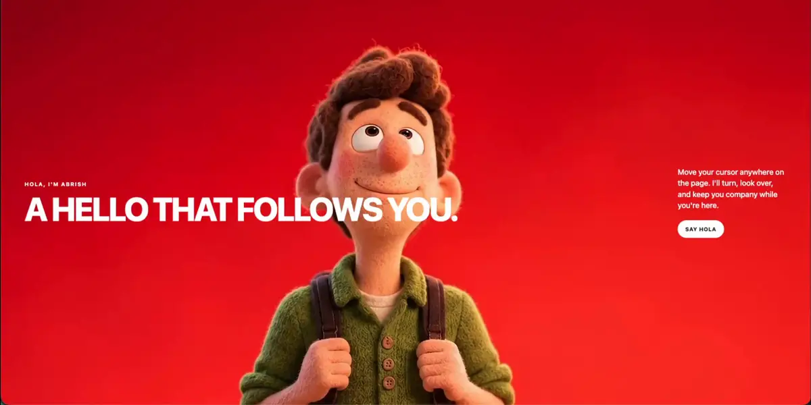

# A hello that follows you

The character follows you. Move around the window and his head turns left, right, up, or down. The rest of him stays put.



The page is one HTML file. It does not play the clip as a video. It swaps still frames, which keeps the head locked to the cursor instead of waiting on the browser to seek.

## Try it

From this folder:

```bash
python3 -m http.server 8765
```

Open [http://127.0.0.1:8765/](http://127.0.0.1:8765/).

Move the pointer to the edges of the window. Near the middle, he settles back to the pose he was just holding.

## What you see

| | |
| --- | --- |
| Label | Hola, I'm Abrish |
| Headline | A hello that follows you. |
| Line | Move your cursor anywhere on the page. I'll turn, look over, and keep you company while you're here. |
| Pill | Say hola |

The copy sits on top of the frames and does not block the cursor.

## How the look is chosen

The source clip is 8 seconds at 24 fps, 192 frames. `index.html` maps the pointer to a time in that clip, eases toward it, then shows `frames/f001.jpg` through `frames/f192.jpg`.

| Pointer | Time in the clip |
| --- | --- |
| Left | toward 1.7s |
| Right | toward 3.85s |
| Up | toward 5.55s |
| Down | toward 7.75s |

Left and right share a rest around 2.9s. Up and down share a rest around 6.45s. Crossing from a side look to an up or down look jumps to that rest first, so his head does not sweep through the whole clip on the way.

The right-hand glance in this clip is smaller than the turn to the left. That is the performance in the file, not a bug in the page.

## Replace the clip

Export every frame in order. The page expects 192 files named `f001.jpg` to `f192.jpg`.

```bash
mkdir -p frames
ffmpeg -y -i your-clip.mp4 -q:v 4 frames/f%03d.jpg
```

If the new clip is a different length, or the looks land at different times, update `frameCount` and the times inside `poseFromCursor` in `index.html`.

`character.mp4` is the same performance with every frame stored as a keyframe. It is there if you want to scrub the file in another tool. Browsers are unreliable at repainting a paused video on every seek, which is why the page uses the JPEGs.

```bash
ffmpeg -i in.mp4 -c:v libx264 -preset medium -crf 18 -g 1 -keyint_min 1 \
  -x264-params "scenecut=0" -profile:v high -pix_fmt yuv420p \
  -movflags +faststart -an character.mp4
```

## Framer

`CursorScrubVideo.tsx` is a Framer code component that scrubs a muted video from the cursor on one axis. Drop that file into a Framer code component and give it an all-keyframe mp4. Use the ffmpeg command above. A normal export will stutter when the playhead jumps.

## Layout

```
index.html                         the page
docs/demo.webp                     the looping preview in this readme
frames/f001.jpg … frames/f192.jpg  one frame per look
character.mp4                      all-keyframe copy of the clip
CursorScrubVideo.tsx               optional Framer scrubber
```
